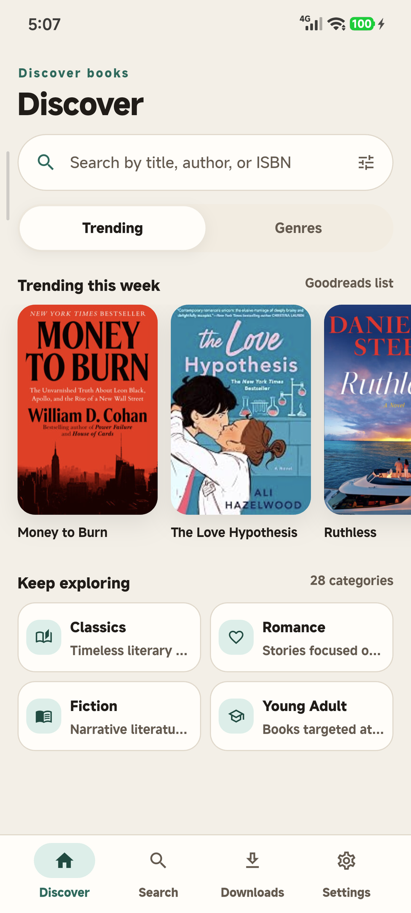
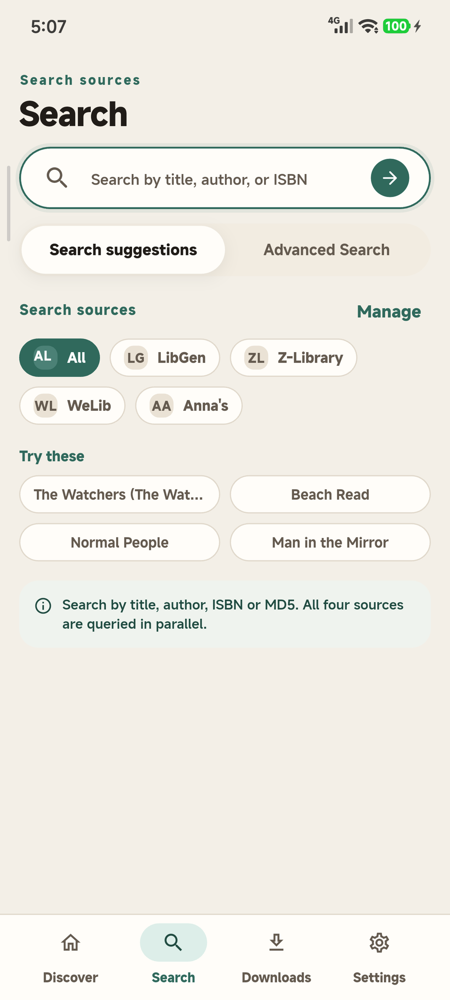
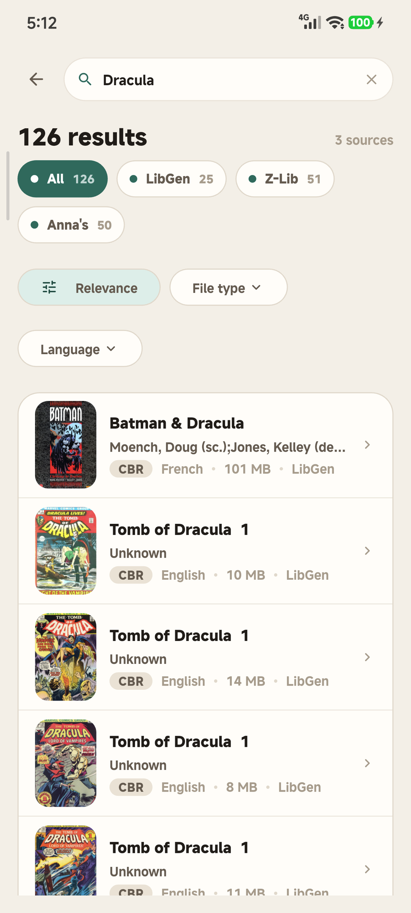
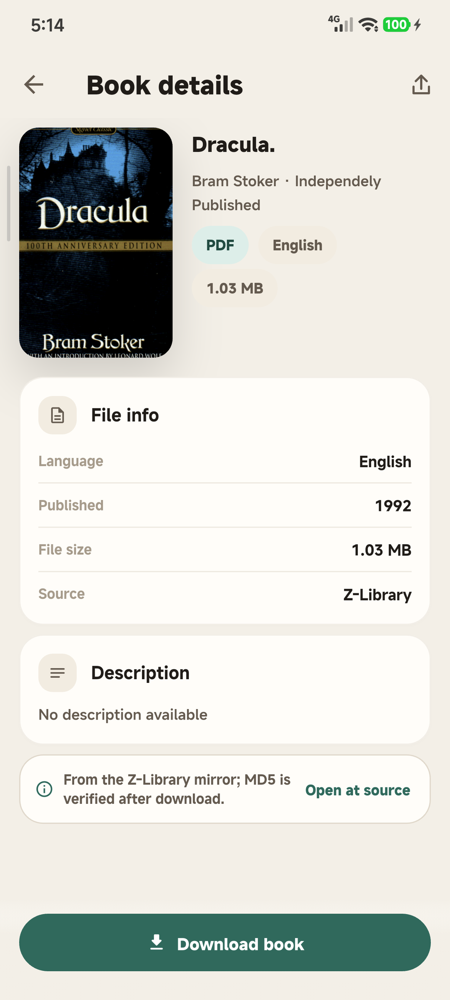
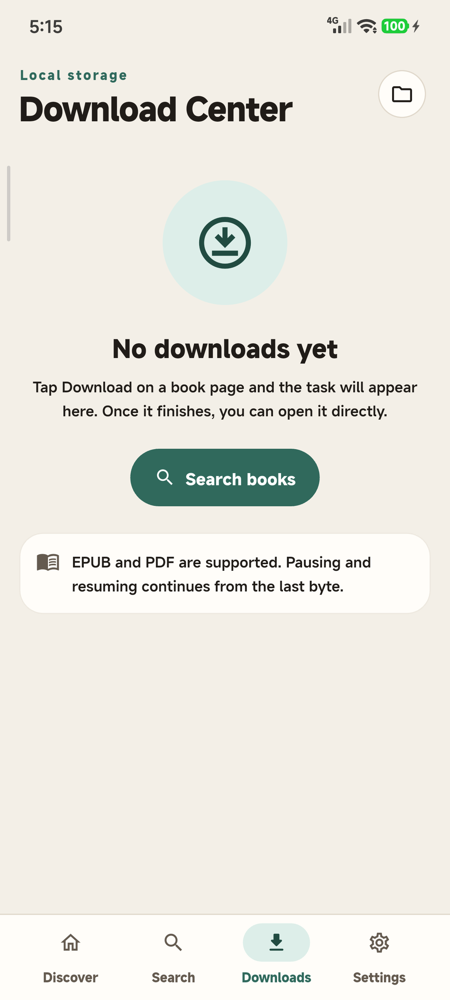
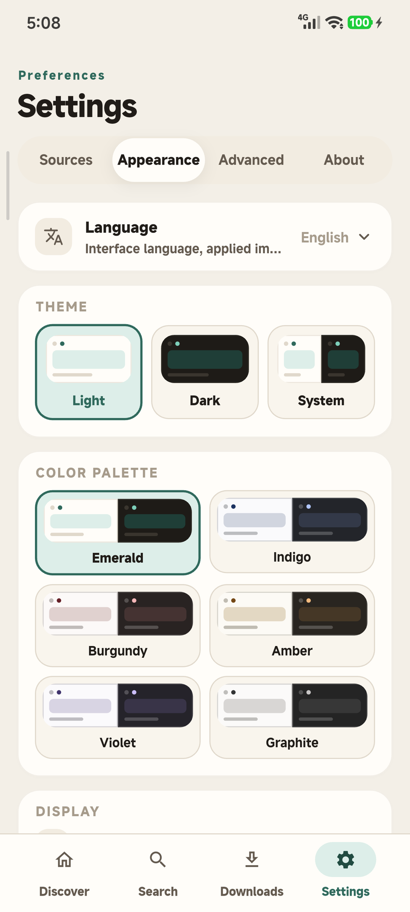

<div align="center">


# OpenlibExtended

**The open-source cross-platform client for shadow libraries. <br/> Search, download, and organize books from Anna's Archive, LibGen, Z-Library, and WeLib on Android, iOS, Windows, and Linux.**
> Fork of [warreth/OpenlibExtended](https://github.com/warreth/OpenlibExtended), originally from [openlib](https://github.com/dstark5/Openlib).

[](https://flutter.dev/)
[](https://opensource.org/licenses/)
[](https://github.com/lzoreal/OpenlibExtended/releases)
[](https://github.com/lzoreal/OpenlibExtended/releases)

[](https://github.com/lzoreal/OpenlibExtended/releases)

**[📖 Frequently Asked Questions (FAQ)](./FAQ.md)**
</div>

## Features ✨

- **Four catalogues, one search**
  Anna's Archive, LibGen, Z-Library, and WeLib are queried in parallel; results stream in as each source answers.

- **Resilient multi-mirror downloads**
  Mirrors come from the SLUM catalogue, are ranked by an on-device latency test, and support resume, retry, and per-mirror failover.

- **Nine ebook formats**
  PDF, EPUB, MOBI, AZW3, FB2, DJVU, TXT, CBR, and CBZ are recognised end to end; downloaded books open in your preferred external reader.

- **Advanced filters**
  Filter by language, file type, and publication year, with search suggestions as you type.

- **Download centre**
  Live progress, pause/resume, retry, batch delete, and completed records backed by a local SQLite library.

- **Local-first data**
  Library, download records, settings, and mirrors stay on device, with JSON backup and restore. Android builds also show download notifications.

## Star History ⭐️

[](https://star-history.com/#lzoreal/OpenlibExtended&Date)

## Roadmap 🎯

- [x] **Enhanced Formats**: PDF, EPUB, MOBI, AZW3, FB2, DJVU, TXT, CBR, and CBZ.
- [ ] **Metadata Editor**: Fix and organize book details manually.
- [ ] **Cloud Sync**: Sync your library and download records with Booklore.
- [ ] **macOS release**: The macOS project exists but is not built or published yet.

## Screenshots 🖼️

[](screenshots/Screenshot_1.png)
[](screenshots/Screenshot_2.png)
[](screenshots/Screenshot_3.png)
[](screenshots/Screenshot_4.png)
[](screenshots/Screenshot_5.png)
[](screenshots/Screenshot_6.png)

## Installation 📦

Grab the latest release from [GitHub Releases](https://github.com/lzoreal/OpenlibExtended/releases).

### Windows (Scoop)

Install via the [Scoop](https://scoop.sh) package manager using this repository as a bucket:

```powershell
scoop bucket add openlibextended https://github.com/lzoreal/OpenlibExtended
scoop install openlibextended
```

The manifest (`bucket/openlibextended.json`) is updated automatically whenever a new release is published, so `scoop update` picks up new versions normally.

### Other platforms

Download the APK, IPA, AppImage, tar.gz or Windows installer directly from the [releases page](https://github.com/lzoreal/OpenlibExtended/releases).

**Android:** releases ship per-ABI APKs — pick the one matching your device's architecture: `arm64-v8a` (most modern phones), `armeabi-v7a` (older 32-bit devices) or `x86_64` (emulators). Each APK contains only the native libraries for its architecture, keeping downloads roughly a third of a universal APK.

**iOS:** the IPA is unsigned and must be sideloaded; in-app updates and notifications are unavailable.

**Linux:** the AppImage and tar.gz builds require WebKitGTK 4.1 for mirror/challenge pages.

**macOS:** the project is present but there is no published build yet.

**Web:** not supported.

**Note:** Publishing this app to the Play Store violates their terms.

## Development 🛠️

```bash
git clone https://github.com/lzoreal/OpenlibExtended.git
flutter pub get
flutter run
```

See [CONTRIBUTING.md](CONTRIBUTING.md) for guidelines.

## Donate 🎁

If you like the app, consider supporting the library itself, the upstream project, or the development of this fork.

- [**Donate To Anna’s Archive**](https://annas-archive.org/donate?tier=1) (Support the library itself)
- [**Sponsor the upstream maintainer on GitHub 💖**](https://github.com/sponsors/warreth) (Support the upstream project)
- [**Sponsor this fork’s maintainer on GitHub 💖**](https://github.com/sponsors/lzoreal) (Support fork-specific work)

## License 📜

Licensed under [AGPL v3.0](https://www.gnu.org/licenses/agpl-3.0.html).

## Disclaimer ⚠️

OpenlibExtended does not own or have any affiliation with the books available through the app. All books are the property of their respective owners and are protected by copyright law. OpenlibExtended is not responsible for any infringement of copyright or other intellectual property rights that may result from the use of the books available through the app. By using the app, you agree to use the books only for personal, non-commercial purposes and in compliance with all applicable laws and regulations.
